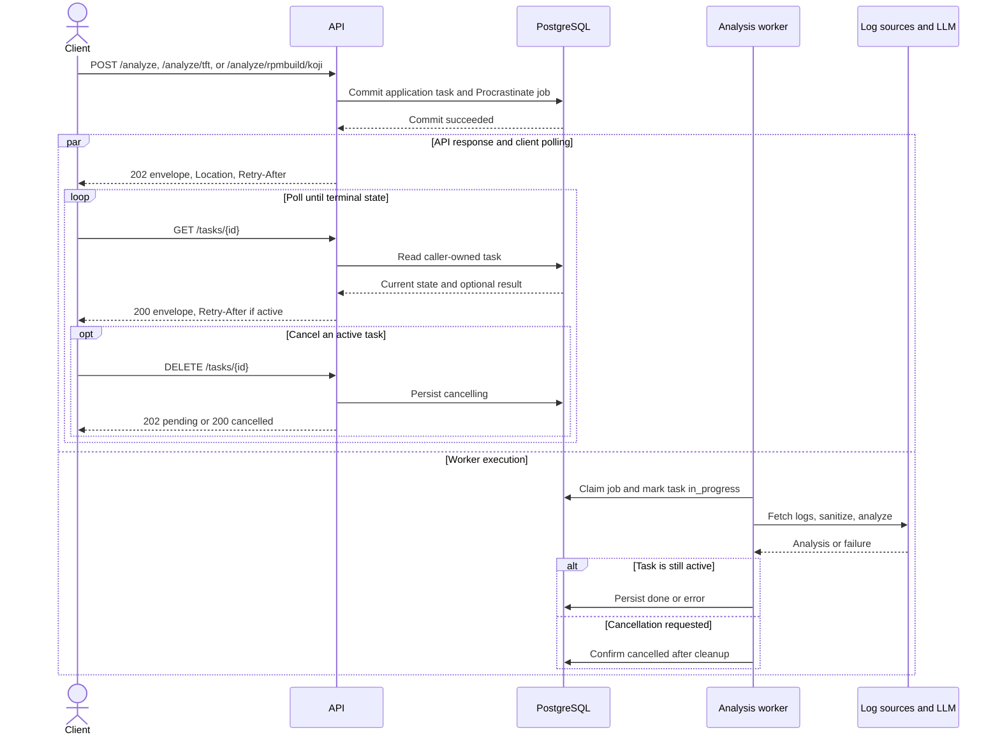

# API guide

Log Detective exposes asynchronous analysis endpoints. See the
[README](../README.md#server) for local setup. A running server also serves the
generated endpoint and field reference at `/docs` and `/openapi.json`.

## Workflow

For new work, the API commits the application task and its Procrastinate job in
one database transaction before acknowledging the request. The worker then
processes the job independently. Generic, Testing Farm, and Koji callers can poll or cancel
their task; GitLab webhooks receive an acknowledgement without a public task URL.

An identical retry with a client-supplied task ID reuses the existing task and
does not enqueue another job. See [Task responses](#task-responses) for status
and cancellation details.

### Time-ordered UML sequence

This example follows a generic, Testing Farm, or Koji request. Time moves downward; the
worker can start as soon as admission commits, while the client receives the
`202` response and polls independently. Elapsed time is not drawn to scale.



The GitLab webhook uses the same durable admission and worker path, but its
acknowledgement is `204 No Content` and it does not expose a polling URL.

## Authentication

Log Detective supports multiple named bearer tokens without putting secrets in
`server/config.yml`. Copy `server/api_tokens.yml.example` to
`server/api_tokens.yml`, replace every example value with a long random token,
and restrict the file so that only the service account can read it. The file is
a YAML mapping whose keys are stable client names and whose values are secret
tokens:

```yaml
packit: "secret-token-for-packit"
monitoring: "different-secret-token"
```

Set `LOGDETECTIVE_TOKENS_FILE` to the file's path and mount it read-only when
running in a container. Clients authenticate with `Authorization: Bearer TOKEN`.
Token names and values must be non-empty and unique, and token values must not
have leading or trailing whitespace; duplicate token names are rejected rather
than overwritten. An invalid configured file prevents server startup. When the
variable is unset, global bearer authentication is disabled for local
development; configured Koji and GitLab token checks still apply. Bearer
authentication covers application routes, including the GitLab webhook, but
FastAPI's built-in `/docs`, `/redoc`, and `/openapi.json` routes remain public.

Only the token name is saved with analysis metrics. Token values are never
stored in the database or included in authentication errors.

## Submitting an analysis

API allows for submission of multiple build artifacts for analysis.
These can be provided using URLs or as raw strings.

```sh
curl --header "Content-Type: application/json" --request POST \
     --data '{
          "files": [
            {
                "name": "build.log",
                "url": "https://url.to/build.log"
            },
            {
                "name": "raw_string.log",
                "content": "Raw string that will be analyzed."
            }
        ],
        "build_metadata": {
            "specfile": null,
            "last_patch": null,
            "commentary": "BuildError: error building package (arch noarch), mock exited with status 30; see root.log for more information",
            "infra_status": null
        }
     }' \
     http://localhost:8080/analyze
```

`files` must contain 1–15 artifacts with distinct names.
Use `url` to fetch a remote HTTP(S) log, or `content` to submit the log text
itself. Remote URLs cannot contain parameters, a query, or a fragment.
By default, DNS answers for these downloads cannot point to private or special
addresses. Operators can list exact DNS names in
`general.ssrf_protection.allowed_hostnames` to permit ordinary private
addresses; names are case-insensitive and an optional trailing dot is ignored.
Wildcards, suffix matching, and IP literals are not supported. All DNS answers,
including redirect destinations, are checked at connection time. Loopback,
link-local/metadata, other special non-routable addresses, and
`general.ssrf_protection.blocked_cluster_cidrs` remain blocked even for allowed
names. The default blocked CIDRs are [Kubernetes kubeadm Service
`10.96.0.0/12`](https://kubernetes.io/docs/reference/setup-tools/kubeadm/kubeadm-init/);
[OpenShift installation example](https://docs.redhat.com/en/documentation/openshift_container_platform/4.20/html-single/installing_on_openstack/index)
Service `172.30.0.0/16`, Pod `10.128.0.0/14`, and common node
`10.0.0.0/16`; and [OpenShift OVN internal ranges](https://docs.redhat.com/en/documentation/openshift_container_platform/4.20/html-single/networking_overview/networking_overview)
`100.64.0.0/16` and `100.88.0.0/16`.
Setting `general.ssrf_protection.blocked_cluster_cidrs` replaces all defaults;
set it to the deployment's actual cluster ranges to avoid blocking unrelated
private hosts. Set `general.block_localhost_urls: false` to disable these
address checks for generic and Testing Farm remote-log downloads; configured allow-list and CIDR
values are still validated but have no effect while disabled.
Analysis submissions require a valid `Content-Length` header; the declared
request size must fit within `general.max_artifact_size` in
`server/config.yml`. A missing or invalid length returns `411`, and an
oversized length returns `413`. A URL that parses but violates the remote URL
restrictions returns `400`; malformed URLs and other request-model validation
failures return `422`.

Remote artifacts are also size-checked as their bytes are downloaded, even if
the remote server omits `Content-Length` or reports a smaller size. This check
runs in the worker after the analysis request has been accepted.

`build_metadata.commentary` and `build_metadata.infra_status` provide context to
the agent; `specfile` and `last_patch` are accepted but currently unused.

### Testing Farm analysis

`POST /analyze/tft` accepts one complete tmt schedule entry/suite per task,
regardless of guest count. The request has
one suite context, published shared artifact references, and every failed, errored,
or `needs_inspection` testcase in `cases`. `case_id` must be unique within the
request. Zero cases are accepted when suite `state` is `error`, `result` is
`failed` or `error`, or error details are present. An empty case list alone
does not establish that no tests ran.
Cases without case-specific artifacts can be analyzed when a shared artifact is available.
The optional UUIDv4 `id`, bearer authentication, and polling/cancellation
lifecycle are unchanged. The endpoint accepts published artifact URLs, not inline file contents.
Use `shared_artifacts` for suite-wide files, `cases[].artifacts` for case files,
and `artifact_refs` in checks/subresults for scoped references.

```json
{
  "suite": {
    "plan": "/example/plan",
    "result": "failed",
    "stage": "complete",
    "requested_environment": {
      "compose": "Fedora-Rawhide",
      "arch": "x86_64"
    }
  },
  "guests": {
    "guest-1": {
      "role": "server",
      "requested_environment": {
        "compose": "Fedora-Rawhide",
        "arch": "x86_64"
      }
    }
  },
  "shared_artifacts": [
    {
      "name": "tmt-run.log",
      "url": "https://example.com/tmt-run.log"
    }
  ],
  "cases": [
    {
      "case_id": "case-1",
      "name": "/example/test",
      "result": "failed",
      "guest_name": "guest-1",
      "serial_number": 1,
      "notes": [
        "assertion failed"
      ],
      "checks": [
        {
          "name": "assert",
          "artifact_refs": [
            "case/case-1/testout.log"
          ]
        }
      ],
      "artifacts": [
        {
          "name": "testout.log",
          "url": "https://example.com/testout.log"
        }
      ]
    }
  ]
}
```

Only non-secret requested/provisioned environment fields (`compose`, `arch`,
`pool`) and selected check/subresult fields are accepted; local paths, secrets,
and arbitrary testcase properties are not. Guest names resolve through the
`guests` map; check/subresult `artifact_refs` must name own or shared artifacts.
There is no reference-count or testcase-count limit. The request body and cumulative downloaded artifacts share
the configured 50 MiB limit. Oversized requests are rejected, never chunked or
silently reduced. URLs obey the generic endpoint's HTTP(S), query/fragment,
size, and optional SSRF protections. Context and artifacts are untrusted data.

Each artifact fetch uses `general.log_source_request_timeout`. Failed downloads
produce `result.retrieval_warnings` entries with a stable code, namespaced
`source_file`, and safe message. Unsupported response charsets are treated as
artifact retrieval failures; their downloaded bytes still count toward the
aggregate limit. Successful own or shared artifacts keep a case
eligible; a case with no usable evidence receives `artifact_error`. Failed URLs
are cached within the task, as are successful URLs. Aggregate byte violations
fail the entire task, including bytes read by unsuccessful downloads.
Artifacts are namespaced as `shared/<name>` or `case/<case_id>/<name>`.
Names must be unique within each scope; the same name in different cases or
in shared artifacts does not collide, even when contents or URLs are identical.
URL caching avoids repeated downloads but does not merge source identities.
The worker pre-extracts Drain evidence once from every available artifact before
one logical agent run; optional extraction tools remain available. One agent
run may make multiple model-provider requests. See [Agent tools](agent-tools.md)
for extraction details. For GitLab.com downloads failing with HTTP 429, the
agent may suggest bundling files or using an available gitlab.cee.redhat.com mirror.
All submitted case and guest context is supplied to that agent run,
including notes, checks, and results from cases whose artifacts are unavailable.
Diagnosis eligibility is supplied separately: only cases with usable own or
shared artifacts may receive diagnoses; the others retain `artifact_error`. Transient
inference timeouts and rate limits retry the whole suite under the shared retry
policy. Context/output-limit failures are task errors, never silent truncation.
As with generic analysis, `general.analysis_timeout` limits each agent attempt.
Suite pre-extraction consumes the first attempt’s budget; completed evidence is
reused on transient inference retries, which receive fresh attempt deadlines.
Individual downloads use `general.log_source_request_timeout`. There is no
separate suite deadline: queue waiting, downloads, and retry delays do not
consume the agent timeout, and total task time can exceed it. Clients cancel
unwanted work through `DELETE /tasks/{id}`; stopping polling does not cancel it.
Already-running blocking calls must finish before timeout or cancellation is
reported as terminal.

The `202` envelope has `taskType: "tft_suite"` and a `Location` at the unchanged
`/tasks/{id}` resource. A terminal successful task returns
`result.cases[case_id] = {"status":"done", "analysis":{...}}` or a per-case
`{"status":"error", "error":{"code":"artifact_error"|"missing_analysis", ...}}`.
An evidence-less case or missing/empty case output does not discard other
diagnoses. With zero cases, `result.cases` is empty and
`result.suite_fallback` contains the analysis. Each analysis retains
`explanation`, `solution`, `no_issue_found`, and `snippets`. Case `snippets` contain
only own-artifact evidence, never shared or sibling artifacts. Shared evidence is stored
once in `result.shared_snippets`, an index from `source_file:line_number` to a
list of distinct snippet variants. Each analysis has `shared_snippet_refs`, a
list of keys into that index; each reference includes every variant at that
location. The application supplies all collected shared locations, not only
those cited by the model. Suite fallback has empty `snippets` and uses the same
reference mechanism. Empty shared evidence produces `{}` and empty reference
lists. Locations retain collection order, with pre-extracted evidence before
optional extractor variants at each
location. Distinct texts can share a filename and starting line; identical variants
are deduplicated. Only the successful attempt's optional extraction is included.
The agent is still asked to cite supplied filenames and starting line numbers in
its explanation. These prose citations are model-generated claims, not validated
references: incorrect citations remain unchanged and do not affect task success
or select the attached evidence. The authentic extracted snippets allow independent
verification but do not guarantee the explanation's accuracy. No structured
citation list is requested; unsolicited citation fields are ignored. Request-side
check/subresult `artifact_refs` remain validated.
Duplicate/unknown agent IDs fail the whole task; inference failure,
timeout, and cancellation also remain task-level outcomes. Partial results are
never visible before completion. TFT request statistics are at `/metrics/analyze-tft/`.

### Task responses

Analysis endpoints use asynchronous request/reply. A successful `POST` returns
`202 Accepted`, a `Location` header pointing to `/tasks/{id}`, and a
`Retry-After` header. The JSON response is a stable task envelope; it does not
contain an analysis result until processing finishes:

```json
{
  "id": "7d036221-ec50-4d31-b714-09edaccf1486",
  "taskType": "generic",
  "createdAt": "2026-09-18T10:00:00Z",
  "status": "scheduled",
  "error": null,
  "result": null
}
```

Poll the URL in `Location` with `GET`. It returns `200` and the same envelope
while `status` is `scheduled`, `in_progress`, or `cancelling`, including
`Retry-After` while more polling is useful. A terminal response has status
`done`, `error`, or `cancelled`; `result` is populated only for `done`.
Cancel an owned operation with `DELETE /tasks/{id}`. Cancellation returns
`202` while process cleanup is pending and `200` once cancellation is
confirmed. Clients may supply a UUIDv4 as the request body's optional `id`;
repeating the identical request with that ID returns the original operation,
while reusing it for different input or credentials returns `409`. Once the
original operation expires, retries using its ID return `409` until retention
cleanup removes the record; use a new ID to submit a new operation.

#### Completed normal analysis

For `POST /analyze`, `result` contains one analysis:

```json
{
  "id": "7d036221-ec50-4d31-b714-09edaccf1486",
  "taskType": "generic",
  "createdAt": "2026-09-18T10:00:00Z",
  "status": "done",
  "error": null,
  "result": {
    "explanation": "The build failed because a required header was missing.",
    "solution": "Add the package providing the header to the build dependencies.",
    "no_issue_found": false,
    "snippets": [
      {
        "text": "fatal error: example.h: No such file or directory",
        "line_number": 42,
        "source_file": "build.log"
      }
    ]
  }
}
```

#### Completed Testing Farm analysis

For `POST /analyze/tft`, the same task envelope contains per-case outcomes.
Each successful case's `analysis` uses the normal analysis structure above.
A task can finish with `status: "done"` while individual cases have errors:

```json
{
  "id": "87f9365a-311e-4c98-972c-e297681f1d12",
  "taskType": "tft_suite",
  "createdAt": "2026-09-18T10:00:00Z",
  "status": "done",
  "error": null,
  "result": {
    "cases": {
      "case-1": {
        "status": "done",
        "analysis": {
          "explanation": "The test failed because the service was unavailable.",
          "solution": "Start the service before running the test.",
          "no_issue_found": false,
          "snippets": [
            {
              "text": "Connection refused",
              "line_number": 12,
              "source_file": "case/case-1/test.log"
            }
          ],
          "shared_snippet_refs": ["shared/tmt.log:5"]
        },
        "error": null
      },
      "case-2": {
        "status": "error",
        "analysis": null,
        "error": {
          "code": "artifact_error",
          "message": "Unable to retrieve a case artifact"
        }
      }
    },
    "shared_snippets": {
      "shared/tmt.log:5": [
        {
          "text": "Service startup failed",
          "line_number": 5,
          "source_file": "shared/tmt.log"
        }
      ]
    },
    "suite_fallback": null,
    "retrieval_warnings": []
  }
}
```

When the request contains no cases, `cases` is empty and `suite_fallback`
contains a normal analysis of the suite context and any shared artifacts.
`retrieval_warnings` lists
unavailable artifacts, each with `code`, `source_file`, and `message`.
Task-level failures use the same top-level `error` object for both endpoints,
with `status: "error"` and `result: null`.

### Koji and GitLab

Koji analysis follows the same contract through
`POST /analyze/rpmbuild/koji` with a body such as
`{"kojiInstance": "fedora", "taskId": 123}`. The instance must be configured.
A completed Koji task's `result` contains `task_id`, `log_file_name`, and a
nested `response` with the analysis. The former Koji path-ID endpoints and
callback header are removed.

> **Note:** If the server operator configured tokens for a Koji instance,
> authorized clients must send one in `X-Koji-Token`. These are Log Detective
> endpoint secrets, not Koji user credentials.

Run [scripts/test_request.sh](../scripts/test_request.sh) on Linux with Bash,
curl, jq, two Koji task URLs in `TASK_URLS`, and a local server with a configured
Koji instance and analysis worker. The script sends no authentication headers,
so global bearer and Koji token checks must be disabled. It tests concurrent
submission, retries, conflicts, polling, and cancellation, and saves responses
under `test_results/` by default.

GitLab uses `POST /webhook/gitlab/job_events` when at least one instance is
configured. It requires `X-Gitlab-Instance` set to a recognized, configured
forge URL. The webhook returns `204` after durable queue admission and has no
public task resource. An expired GitLab source still awaiting retention cleanup
receives `409` on redelivery.

> **Note:** If the server operator configures webhook secrets for that GitLab
> instance, the GitLab webhook must send one in `X-Gitlab-Token`. This webhook
> secret is distinct from the API token the server uses to call GitLab.

Before sending logs to the LLM, Log Detective redacts some personal
identifiers, including email addresses, GPG fingerprints, RSA keys, and public
key identifiers. Email matching accepts `@`, `(at)`, and `[at]` separators and
redacts address-shaped text with malformed dotted domains, such as
`user@-domain.com`. Numeric hosts, systemd unit names ending in `.service`,
`.socket`, `.timer`, or another unit suffix, and `.journal` names remain visible
because they also use `@` in build logs. The suffix exemption applies to the
whole candidate, including dotted instances such as `alice@example.com.service`.

See [Appendix: HTTP response reference](#appendix-http-response-reference) for
all endpoint responses, including errors.

## Metrics

You can query request and response statistics via `metrics` endpoints
using `GET` method at `/metrics/ENDPOINT_TYPE/`. The endpoint returns data
in JSON format with a `metrics` list of dictionaries containing metadata
about endpoint type and time series of data aggregated at the given granularity.
For asynchronous generic and Koji analysis, response time runs from request
receipt until the first terminal task response is sent by `GET /tasks/{task_id}`;
active polling responses do not count. For GitLab webhooks, it runs from request
receipt until the analysis result is published as a merge request comment.
Completion time runs from request receipt to the terminal outcome, including time
waiting in the queue. Response length measures the serialized analysis result in
characters when one is available.

1. `ENDPOINT_TYPE`: `analyze`, `analyze-koji`, or `analyze-gitlab`.
2. `start_time`: Timestamp, indicating inclusive start of the query
3. `end_time`: Optional exclusive timestamp, defaults to current UTC time
4. `time_period`: Granularity of the aggregation, 'hour', 'day' or 'month'.

Use the optional `api_token_name` query parameter to restrict statistics to a
single named token. Without it, statistics include all tokens and historical
records without token attribution.

Example calls:

```sh
curl "http://localhost:8080/metrics/analyze-gitlab/?start_time=2026-09-01T00:00:00Z&time_period=day"
curl "http://localhost:8080/metrics/analyze/?start_time=2026-09-01T00:00:00Z&end_time=2026-09-08T00:00:00Z&time_period=day&api_token_name=packit"
```

Example response:

```json
{
  "metrics": [
    {
      "endpoint": "analyze",
      "period_start": [],
      "total_count": [],
      "average_response_time": [],
      "average_response_len": [],
      "average_completion_time": []
    }
  ]
}
```

## Worked example

Log Detective can work with any logs, though we optimize it for RPM build logs.
The analysis output below is an excerpt of the `result` field from a completed
`GET /tasks/{id}` response. The initial `POST /analyze` returns the task
envelope shown in [Task responses](#task-responses).

The analyzed build: https://koji.fedoraproject.org/koji/taskinfo?taskID=149750933

You can get similar output by running this on your local compose:

```sh
curl --header "Content-Type: application/json" --request POST \
     --data '{
        "files": [
            {
                "name": "root.log",
                "url": "https://kojipkgs.fedoraproject.org//work/tasks/933/149750933/root.log"
            },
            {
                "name": "mock_output.log",
                "url": "https://kojipkgs.fedoraproject.org//work/tasks/933/149750933/mock_output.log"
            },
            {
                "name": "build.log",
                "url": "https://kojipkgs.fedoraproject.org//work/tasks/933/149750933/build.log"
            }
        ],
        "build_metadata": {
            "specfile": null,
            "last_patch": null,
            "commentary": "Logs are from a Koji build.\nKoji builds use mock chroots; build.log contains build output,\nroot.log has dependency resolution and mock setup.",
            "infra_status": null
        }
     }' \
     http://localhost:8080/analyze
```

Note that only a handful of snippets were selected from the original response for demonstration purposes:

When the agent attaches a description to a snippet using the `snippet_annotation` tool,
that snippet also has a `snippet_analysis` field.

```json
{
  "explanation": "The build failed during the compilation phase of `emacs-with-editor` because the build process could not find a required load file, specifically `cond-let`, while compiling `with-editor.el` (build.log, line 104). This indicates a missing dependency or an incomplete build environment setup for Emacs Lisp components.",
  "no_issue_found": false,
  "snippets": [
    {
      "line_number": 585,
      "source_file": "root.log",
      "text": "DEBUG util.py:535:  Warning: skipped OpenPGP checks for 124 packages from repository: build"
    },
    {
      "line_number": 5276,
      "source_file": "root.log",
      "text": "DEBUG util.py:535:  Package \"emacs-1:31.1-2.fc46.ppc64le\" is already installed."
    },
    {
      "line_number": 3,
      "source_file": "mock_output.log",
      "text": "INFO: mock.py version 6.8 starting (python version = 3.14.7, NVR = mock-6.8-1.fc44), args: /usr/libexec/mock/mock -r koji/f46-build-70856970-6688917 --new-chroot --init"
    },
    {
      "line_number": 275,
      "source_file": "mock_output.log",
      "text": "INFO: Buildroot is handled by package management installed into bootstrap:\n  rpm-6.1.0-1.fc46.ppc64le\n  rpm-sequoia-1.10.2-5.fc45.ppc64le\n  dnf5-5.4.3.0-2.fc46.ppc64le\n  dnf5-plugins-5.4.3.0-2.fc46.ppc64le"
    },
    {
      "line_number": 287,
      "source_file": "mock_output.log",
      "text": "ERROR: Exception(/var/tmp/koji/tasks/933/149750933/local/work/tasks/907/149750907/emacs-with-editor-3.5.4-1.fc46.src.rpm) Config(f46-build-70856970-6688917) 3 minutes 59 seconds"
    },
    {
      "line_number": 289,
      "source_file": "mock_output.log",
      "text": "ERROR: Command failed: \n # /usr/bin/systemd-nspawn -q -M ee22ca6a19f040769a6c490430569274 -D /var/lib/mock/f46-build-70856970-6688917/root -a -u mockbuild --capability=cap_ipc_lock --capability=cap_mac_admin --bind=/dev/btrfs-control --bind=/dev/mapper/control --bind=/dev/fuse --bind=/dev/loop-control --bind=/dev/loop0 --bind=/dev/loop1 --bind=/dev/loop2 --bind=/dev/loop3 --bind=/dev/loop4 --bind=/dev/loop5 --bind=/dev/loop6 --bind=/dev/loop7 --bind=/dev/loop8 --bind=/dev/loop9 --bind=/dev/loop10 --bind=/dev/loop11 --resolv-conf=off --console=pipe --setenv=TERM=vt100 --setenv=SHELL=/bin/bash --setenv=HOME=/builddir --setenv=HOSTNAME=mock --setenv=PATH=/usr/bin:/bin:/usr/sbin:/sbin '--setenv=PROMPT_COMMAND=printf \"\\033]0;<mock-chroot>\\007\"' '--setenv=PS1=<mock-chroot> \\s-\\v\\$ ' --setenv=LANG=C.UTF-8 bash --login -c '/usr/bin/rpmbuild -bb --noclean --target noarch --nodeps /builddir/build/SPECS/emacs-with-editor.spec'"
    },
    {
      "line_number": 118,
      "source_file": "build.log",
      "text": "Cannot find a locale compatible with document strings translations"
    },
    {
      "line_number": 133,
      "source_file": "build.log",
      "text": "RPM build errors:"
    },
    {
      "line_number": 134,
      "source_file": "build.log",
      "text": "error: Bad exit status from /var/tmp/rpm-tmp.Us2T6p (%build)\n    Bad exit status from /var/tmp/rpm-tmp.Us2T6p (%build)"
    }
  ],
  "solution": "Ensure that all necessary Emacs Lisp development dependencies, including any required libraries that provide `cond-let`, are correctly installed and available in the build environment before running the build process."
}
```

The most significant field for diagnosis is `explanation`, a plain text string.
`solution` is a plain text string when a fix is suggested, or `null` otherwise.

## Appendix: HTTP response reference

The table covers the application routes. A task's analysis failure is reported
as `status: "error"` in its task envelope, not as an HTTP error from polling.
Here, **task envelope** means the JSON object shown in [Task responses](#task-responses).

| Method and path | HTTP status | Response and condition |
| --- | --- | --- |
| `POST /analyze` | `202 Accepted` | Task envelope, `Location`, and `Retry-After`; a new task or an identical retry. |
| `POST /analyze` | `400 Bad Request` | JSON `detail`; an artifact URL parses but violates remote URL restrictions. |
| `POST /analyze` | `409 Conflict` | JSON `detail`; a supplied task ID conflicts with another request or an expired task. |
| `POST /analyze/tft` | `202 Accepted` | Task envelope, `Location`, and `Retry-After`; a new task or an identical retry. |
| `POST /analyze/tft` | `400 Bad Request` | JSON `detail`; an artifact URL violates remote URL restrictions. |
| `POST /analyze/tft` | `409 Conflict` | JSON `detail`; a supplied task ID conflicts with another request or an expired task. |
| `POST /analyze/rpmbuild/koji` | `202 Accepted` | Task envelope, `Location`, and `Retry-After`; a new task or an identical retry. |
| `POST /analyze/rpmbuild/koji` | `401 Unauthorized` | JSON `detail`; the configured Koji token is missing or invalid. |
| `POST /analyze/rpmbuild/koji` | `404 Not Found` | JSON `detail`; the Koji instance is unknown. |
| `POST /analyze/rpmbuild/koji` | `409 Conflict` | JSON `detail`; a supplied task ID conflicts with another request or an expired task. |
| Analysis `POST` routes | `411 Length Required` | JSON `detail`; `Content-Length` is missing or invalid. |
| Analysis `POST` routes | `413 Content Too Large` | JSON `detail`; the declared request size exceeds `general.max_artifact_size`. |
| `GET /tasks/{id}` | `200 OK` | Task envelope; active tasks include `Retry-After`, and terminal tasks include their outcome. |
| `GET /tasks/{id}` | `404 Not Found` | JSON `detail`; the task is absent, expired, or belongs to another token. |
| `DELETE /tasks/{id}` | `202 Accepted` | Task envelope and `Retry-After`; cancellation is still pending. |
| `DELETE /tasks/{id}` | `200 OK` | Task envelope; cancellation is confirmed or the task was already cancelled. |
| `DELETE /tasks/{id}` | `404 Not Found` | JSON `detail`; the task is absent or belongs to another token. |
| `DELETE /tasks/{id}` | `409 Conflict` | JSON `detail`; a completed task cannot be cancelled. |
| `POST /webhook/gitlab/job_events` | `204 No Content` | Empty body; the event was durably admitted. Available only when a GitLab instance is configured. |
| `POST /webhook/gitlab/job_events` | `400 Bad Request` | Empty body; `X-Gitlab-Instance` is not a recognized forge. |
| `POST /webhook/gitlab/job_events` | `401 Unauthorized` | Empty body; the configured GitLab webhook token is missing or invalid. |
| `POST /webhook/gitlab/job_events` | `404 Not Found` | Empty body; the forge is recognized but is not configured. |
| `POST /webhook/gitlab/job_events` | `409 Conflict` | Empty body; the source task has expired but is still retained. |
| `GET /metrics/{route}/` | `200 OK` | JSON `metrics` list for the requested endpoint and time period. |
| `GET /metrics/{route}/` | `400 Bad Request` | JSON `detail`; `start_time` is not earlier than `end_time`. |
| `GET /metrics/{route}/` | `404 Not Found` | JSON `detail`; GitLab metrics were requested with no GitLab instance configured. |
| `GET /version` | `200 OK` | Plain version string. |
| All application routes | `401 Unauthorized` | JSON `detail` and `WWW-Authenticate: Bearer` when global bearer authentication is enabled and the bearer token is missing or invalid. |
| Routes with request fields, query parameters, or path parameters | `422 Unprocessable Content` | JSON `detail` array describing malformed or invalid input, including a malformed task UUID, unknown metrics route, or missing GitLab instance header. |
| Path with a mismatched trailing slash | `307 Temporary Redirect` | Redirect to the registered path, such as `/metrics/analyze/`. |
| Unknown path | `404 Not Found` | JSON `detail`; no route matches. |
| Unsupported method on a known path | `405 Method Not Allowed` | JSON `detail`; the path exists but does not support the method. |
| Any application route | `500 Internal Server Error` | Unexpected server failure; no stable API error body. |

The `/docs`, `/redoc`, and `/openapi.json` documentation routes are provided by
FastAPI separately from the application routes above.
